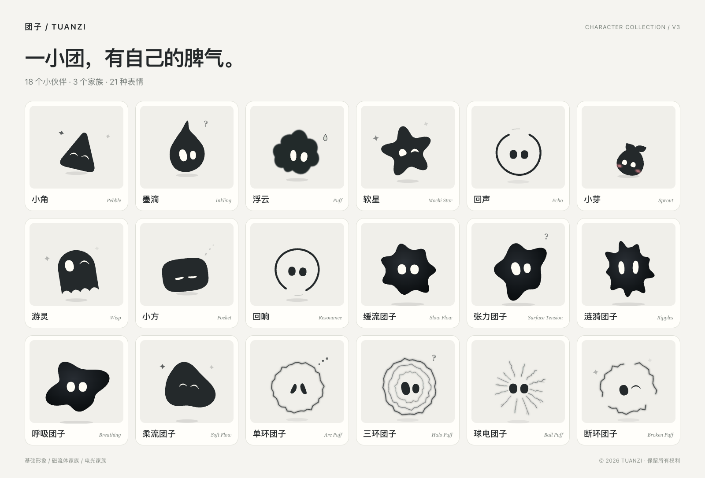
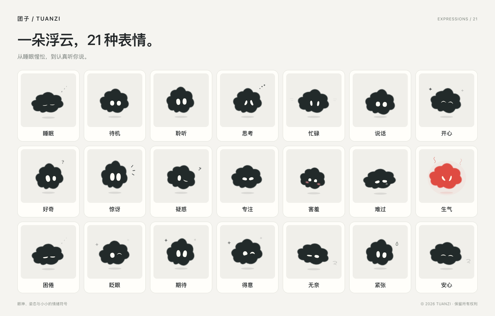
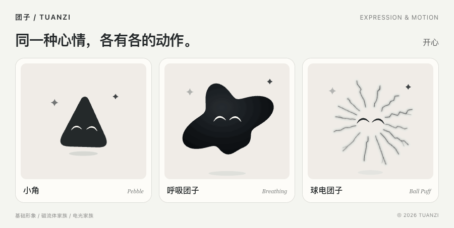

# 团子 / TUANZI

一小团，有自己的脾气。

**[在线体验](https://liz2z.github.io/tuanzi/)** · [授权联系](https://github.com/Liz2Z/tuanzi/issues)

19 个形象，包含基础形象、磁流体家族与电光家族。22 种表情，支持视线跟随、自然眨眼和自动演示；不同形象拥有各自的动作，辅助标志会随身体轮廓让位。

## 表情与动作

从睡眠、聆听和思考，到开心、害羞与生气。

同一种心情，各有各的动作。小角会蹦跳，磁流体会舒展，电光会收放。

首页为 V5，本地打开 [index.html](index.html) 或 [expressions-v5.html](expressions-v5.html) 即可体验；[V4](expressions-v4.html)、[V3](expressions-v3.html)、[V2](expressions-v2.html) 与[初版眼神设计](expressions-v1.html) 保留供对比。

## 灵感来源

眼神与表情设计的灵感来自 [grok-ball](https://tycoding.github.io/grok-ball/)（[源码仓库](https://github.com/tycoding/grok-ball)）。感谢原作者的分享。

## 使用与授权

© 2026 团子 / TUANZI。保留所有权利。

本仓库仅公开展示，不提供公共使用许可，不授予商用许可。非商用使用也须事先取得明确书面许可；申请请通过 [Issues](https://github.com/Liz2Z/tuanzi/issues) 联系。署名、注明来源或提出申请均不等于获得授权。

法律允许的使用及 GitHub 平台条款授予的权限不受本声明限制。完整声明见 [LICENSE](LICENSE)。
